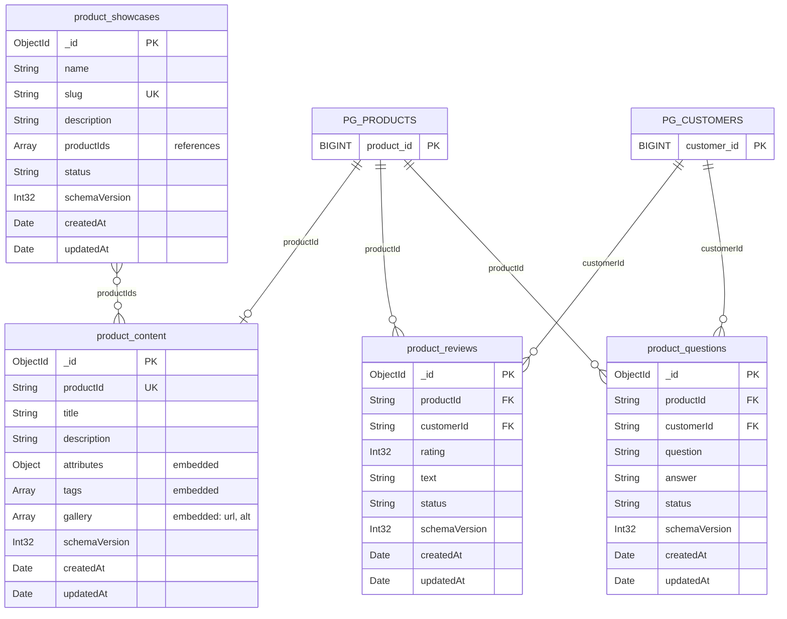

# Диаграмма модели MongoDB

## Описание модели

| Связь | Тип | Реализация |
|---|---|---|
| `product_content` → `product_reviews` | 1:N | reference: `product_reviews.productId` |
| `product_content` → `product_questions` | 1:N | reference: `product_questions.productId` |
| `product_showcases` ↔ `product_content` | M:N | массив reference `product_showcases.productIds` |
| `customers` ↔ товары через отзывы | M:N | `product_reviews` с уникальным индексом `{ productId, customerId }` |
| `product_content` → `attributes`, `tags`, `gallery` | 1:1 | embedding внутри документа товара |
| `product_questions` → `answer` | 1:1 | embedding внутри документа вопроса |

`PG_PRODUCTS` и `PG_CUSTOMERS` — таблицы PostgreSQL `products` и `customers`. Ссылки на них хранятся строками с десятичным значением `BIGINT`, внешних ключей между СУБД нет.
